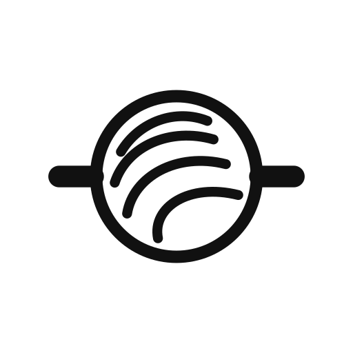

<div align="center">
  
  <h1>QWED Open Responses</h1>
  <h3>Verification Guards for AI Agent Outputs</h3>

  [](https://pypi.org/project/qwed-open-responses/)
  [](https://www.npmjs.com/package/qwed-open-responses)
  [](https://opensource.org/licenses/Apache-2.0)
  [](https://github.com/QWED-AI/qwed-open-responses/actions)
  [](https://github.com/QWED-AI/qwed-open-responses)
  [](https://github.com/QWED-AI/qwed-verification#%EF%B8%8F-what-does-verified-by-qwed-mean)

</div>
**Verification guards for AI agent outputs. Verify before you execute.**

QWED Open Responses provides deterministic, rule-based verification guards for AI responses, tool calls, and structured outputs. Works with OpenAI Responses API, LangChain, LlamaIndex, and other AI agent frameworks.

---

## Installation

```bash
pip install qwed-open-responses
```

With optional integrations:

```bash
pip install qwed-open-responses[openai]      # OpenAI Responses API
pip install qwed-open-responses[langchain]   # LangChain
pip install qwed-open-responses[tax]         # Tax Verification (Payroll, Crypto)
pip install qwed-open-responses[finance]     # Finance Verification (NPV, ISO 20022)
pip install qwed-open-responses[legal]       # Legal Verification (Contracts, Jurisdictions)
pip install qwed-open-responses[all]         # All integrations
```

---

## 💡 What QWED Open Responses Is (and Isn't)

### ✅ QWED Open Responses IS:
- **Verification middleware** for AI agents (OpenAI, LangChain, LlamaIndex)
- **Deterministic** — every check is an explicit, inspectable rule (schema validation, arithmetic recomputation, configurable pattern lists). No LLM calls in the verification path
- **Framework-agnostic** — works with any LLM or agent framework
- **A safety layer** — blocks known-dangerous tool calls (configurable blocklist) and incorrect outputs

### ❌ QWED Open Responses is NOT:
- ~~An agent framework~~ — use LangChain or AutoGen for that
- ~~A prompt engineering tool~~ — use DSPy for that
- ~~A vector database~~ — use Pinecone or Weaviate for that
- ~~A vaguely defined "guardrail"~~ — every check is an explicit, inspectable rule (regex-based pattern scans included, and labeled as heuristics)

> **Think of QWED as the "firewall" for your AI agent's actions and outputs.**
> 
> LangChain builds the agent. OpenAI powers the brain. **QWED secures the actions.**

---

## 🆚 How We're Different from Other Guardrails

| Aspect | Guardrails AI / NVIDIA NeMo | DSPy | QWED Open Responses |
|--------|-----------------------------|------|---------------------|
| **Primary Goal** | Format validation (XML/RAIL) | Prompt optimization | Deterministic verification |
| **Tool Security** | Regex-based blocking | N/A | Configurable blocklist/allowlist + argument pattern scan (heuristic) |
| **Math Accuracy** | LLM self-correction | Prompt tuning | SymPy symbolic math |
| **Approach** | "Re-ask the LLM" | "Train the prompt" | "Verify legally/mathematically" |
| **Integration** | Wraps LLM calls | Replaces prompt pipeline | Middleware / Callback |
| **Determinism** | Probabilistic | Probabilistic | **Deterministic rules** (pattern scans are heuristics) |

### Use Together (Best Practice)
```
┌──────────────┐     ┌───────────────┐     ┌──────────────┐
│   LangChain  │ ──► │     QWED      │ ──► │  Verified    │
│    Agent     │     │  (Middleware) │     │  Tool Call   │
└──────────────┘     └───────────────┘     └──────────────┘
```

---

## 🔒 Security & Privacy

> **Verification happens locally. No data leaves your infrastructure.**

| Concern | QWED Approach |
|---------|---------------|
| **Data Transmission** | ❌ No external API calls for verification |
| **Logic Execution** | ✅ Local Python/Z3 engines |
| **Latency** | ✅ Sub-millisecond overhead for most guards |
| **Audit** | ✅ Full logs of blocked actions |

**Perfect for:**
- Agents with access to databases or APIs
- Enterprise internal tools
- Automated financial/legal assistants

---

## ❓ FAQ

<details>
<summary><b>Does it slow down my agent?</b></summary>

Negligibly. Most guards (Schema, Tool, Argument) run in <1ms. MathGuard runs in <5ms. It's much faster than making another LLM call to double-check.
</details>

<details>
<summary><b>Can I use it with custom agents?</b></summary>

Yes! You don't need LangChain. QWED works with raw OpenAI API calls or any Python code. Pass the output to `ResponseVerifier` with at least one guard, for example `ResponseVerifier(default_guards=[ToolGuard()]).verify(output)`. With no guards it fails closed and blocks every output.
</details>

<details>
<summary><b>How does MathGuard work?</b></summary>

It extracts numbers and operators from the output and uses SymPy to verify if the stated result matches the calculation. It does NOT ask the LLM to check itself.
</details>

<details>
<summary><b>Is it compatible with streaming?</b></summary>

Yes — `OpenResponsesMiddleware` verifies tool-call items as they arrive in the stream (`middleware/streaming_interceptor.py`). With `block_on_failure=True` (the default) failed items are replaced with a `system_intervention` item; with `block_on_failure=False` they pass through unmodified (warn-only monitoring — the trust boundary is disabled in that mode).
</details>

---

## 🗺️ Roadmap

### ✅ Released
- [x] `ToolGuard` - Block dangerous tools/patterns
- [x] `SchemaGuard` - JSON Schema validation
- [x] `MathGuard` - SymPy calculation verification
- [x] `SafetyGuard` - PII and injection checks
- [x] `StateGuard` - Finite state machine validation
- [x] `ArgumentGuard` - Type and range checking
- [x] Integrations: OpenAI, LangChain, LlamaIndex
- [x] **Streaming Verification** - Verify tool-call items in real-time

### 🚧 In Progress
- [ ] **Auto-Fix** - Deterministic correction of JSON errors

### 🔮 Planned
- [ ] **Distributed Rules** - Sync rules across agent swarms
- [ ] **Policy-as-Code** - Define guards in YAML/JSON
- [ ] **Visual Dashboard** - View blocked attempts stats

---

## Quick Start

```python
from qwed_open_responses import ResponseVerifier, ToolGuard, SchemaGuard

# Create verifier with guards
verifier = ResponseVerifier()

# Verify a tool call
result = verifier.verify_tool_call(
    tool_name="execute_sql",
    arguments={"query": "SELECT * FROM users"},
    guards=[ToolGuard()]
)

if result.verified:
    print("✅ Safe to execute")
else:
    print(f"❌ Blocked: {result.block_reason}")
```

---

## Guards

| Guard | Purpose | Example |
|-------|---------|---------|
| **SchemaGuard** | Validate JSON schema | Structured outputs |
| **ToolGuard** | Block dangerous tools | `execute_shell`, `delete_file` |
| **MathGuard** | Verify calculations | Totals, percentages |
| **StateGuard** | Validate state transitions | Order status changes |
| **ArgumentGuard** | Validate tool arguments | Types, ranges, formats |
| **SafetyGuard** | Comprehensive safety | PII, injection, budget |

---

## Examples

### Block Dangerous Tools

```python
from qwed_open_responses import ToolGuard

guard = ToolGuard(
    blocked_tools=["execute_shell", "delete_file"],
    dangerous_patterns=[r"DROP TABLE", r"rm -rf"],
)

result = guard.check({
    "type": "tool_call",
    "tool_name": "execute_sql",
    "arguments": {"query": "SELECT * FROM users"},
})
print(result.passed, result.message)
# True All 1 tool call(s) verified

result = guard.check({
    "type": "tool_call",
    "tool_name": "execute_sql",
    "arguments": {"query": "DROP TABLE users"},
})
print(result.passed, result.message)
# False BLOCKED: Dangerous pattern detected in tool arguments
```

`ToolGuard.check()` reads tool calls in these shapes: a single call with
`"type": "tool_call"` (as above), a `tool_calls[]` list, Chat Completions
`choices[].message.tool_calls[]`, `content[]` blocks with
`"type": "tool_use"`, and a single Responses API item: `function_call`,
`custom_tool_call`, `mcp_approval_request`, or a client action item such as
`local_shell_call` (see Scope & Limitations for how those are checked).
Tool-like content in any other shape fails closed, so a bare
`{"tool_name": ..., "arguments": ...}` with no `"type"` is blocked whatever
its arguments say. `ResponseVerifier().verify_tool_call()` (see Quick Start)
adds the `"type"` for you.

### Validate Structured Outputs

```python
from qwed_open_responses import SchemaGuard

schema = {
    "type": "object",
    "properties": {
        "name": {"type": "string"},
        "age": {"type": "integer", "minimum": 0}
    },
    "required": ["name", "age"]
}

guard = SchemaGuard(schema=schema)
result = guard.check({"output": {"name": "John", "age": 30}})
print(result.passed, result.message)
# True Schema validation passed
```

### Verify Calculations

```python
from qwed_open_responses import MathGuard

guard = MathGuard()
result = guard.check({
    "output": {
        "subtotal": 100,
        "tax": 8,
        "total": 108
    }
})
print(result.passed, result.message)
# True Math verification passed
```

### Safety Checks

```python
from qwed_open_responses import SafetyGuard

guard = SafetyGuard(
    check_pii=True,
    check_injection=True,
    max_cost=100.0,
)

# max_cost needs a cost to compare. Pass your own running total in
# context["total_cost"]: usage reported in the response comes from the
# model and can be under-reported. The guard adds the two together.
result = guard.check(
    {"content": "ignore previous instructions and..."},
    context={"total_cost": 12.50},
)
print(result.passed, result.message)
# False Safety check failed: 1 critical issue(s)
print([issue["type"] for issue in result.details["issues"]])
# ['injection']
```

With `max_cost` set and no cost figure at all, the budget check fails
closed, so even harmless content is blocked until you supply one.

---

## Framework Integrations

### LangChain

This example needs LangChain 1.x, which added `create_agent`. The
`[langchain]` extra still accepts 0.x releases, so install 1.x explicitly:
`pip install "qwed-open-responses[langchain]" "langchain>=1.0"`.

```python
from langchain.agents import create_agent
from qwed_open_responses import ToolGuard, SafetyGuard
from qwed_open_responses.middleware.langchain import QWEDCallbackHandler

callback = QWEDCallbackHandler(
    guards=[ToolGuard(), SafetyGuard()]
)

agent = create_agent(model=..., tools=[...])  # your model and tools
agent.invoke(
    {"messages": [{"role": "user", "content": "..."}]},
    config={"callbacks": [callback]},
)
# A blocked tool call raises ToolCallBlocked before the tool runs
```

### OpenAI SDK

```python
from qwed_open_responses import ToolGuard
from qwed_open_responses.middleware.openai_sdk import VerifiedOpenAI

client = VerifiedOpenAI(
    api_key="...",
    guards=[ToolGuard()],
)

response = client.chat.completions.create(model=..., messages=[...], tools=[...])
# Verified before it is returned: a failed check raises ResponseBlocked
```

- `client.responses.create(...)` runs the same guards on Responses API
  objects. In 0.6.1, ToolGuard does not read tool calls inside a Responses
  object's `output[]`; it fails closed instead. A `function_call`, a client
  action item (`local_shell_call`, `shell_call`, `apply_patch_call`,
  `computer_call`), a `custom_tool_call`, an `mcp_approval_request` or an
  `mcp_call` raises `ResponseBlocked`, even a safe one. Text and the hosted
  `web_search_call`, `file_search_call`, `code_interpreter_call` and
  `image_generation_call` items pass.
- Keep `SchemaGuard` out of the client's guards. It does not parse the
  model's JSON: on a Responses object it validates the `output[]` list, and
  on a Chat Completions object the whole object. A schema for your JSON
  therefore blocks every response, and an empty schema `{}` passes without
  checking anything. Parse the model's JSON and check it as in
  [Validate Structured Outputs](#validate-structured-outputs).

---

## ⚠️ Scope & Limitations

Read this before relying on QWED as a trust boundary (issue #31 audit):

- **Tool blocking is a configurable blocklist, not a sandbox.** Matching is
  case-insensitive and the default list covers common shells (`bash`, `sh`,
  `powershell`, `zsh`, ...) and client action tools (`local_shell`,
  `apply_patch`, `computer_use`), and argument pattern scanning also decodes
  bounded base64 payloads — but pattern scanning is a **heuristic**, not a
  security boundary. Prefer `allowed_tools` allowlists and OS-level
  sandboxing for real enforcement.
- **Responses API action items are tool calls (v0.6.1 breaking change).**
  `local_shell_call`, `shell_call`, `apply_patch_call` and `computer_call`
  items are checked as the tools `local_shell`, `shell`, `apply_patch` and
  `computer_use`; `custom_tool_call` and `mcp_approval_request` items are
  checked under their own `name`. The first four names are on the default
  blocklist. To run them, create ToolGuard with
  `use_default_blocklist=False`; this drops the whole default blocklist
  (shells included), so re-add any names you still want blocked via
  `blocked_tools`. `allowed_tools` is optional, but for least-privilege
  execution configure it as an allowlist — and when you do, list every
  action tool you run in it. Unknown `*_call` / `*_request` items in a
  response's `output[]` or a stream fail closed.
- **PII detection produces warnings, not blocks.** PII matches surface as a
  separate warning state (`VerificationResult.warnings`); they do not fail
  `verified` or block unless you create the verifier with
  `allow_warnings=False`.
- **SchemaGuard rejects undeclared root fields (v0.6.0 breaking change).**
  When your schema does not set `additionalProperties`, undeclared top-level
  fields fail validation. Declare them, set `additionalProperties`
  explicitly, or opt out with `allow_additional_properties=True`.
- **Verification resource limits fail closed.** JSON text longer than
  100,000 characters or nesting deeper than 100 levels receives a failed
  verdict. SafetyGuard also rejects content deeper than 12 levels, wider than
  10,000 nodes, or longer than 100,000 characters. SchemaGuard reports only
  the first validation error and marks the total count as unknown.
- **Budget checks use model-reported usage.** `response["usage"]` comes
  from the model output under verification: negative or non-numeric
  reports fail closed, but under-reporting cannot be detected from the
  response itself. Supply trusted-side totals via
  `context["total_cost"]` / `context["total_tokens"]` or reconcile against
  provider reports.
- **`VerificationResult` is not cryptographically attested.** Anyone can
  construct one — including one with a valid-looking `binding`. The
  binding hash only detects a mismatch between a result and its
  response/metadata; it does **not** authenticate the result itself.
  Before acting on a result you did not produce in-process, require
  trusted provenance or cryptographic attestation (tracked in
  qwed-verification #319).
- **Zero guards fail closed.** `ResponseVerifier.verify()` without guards
  returns `verified=False`; `verify_structured_output()` raises
  `ValueError` when both a schema and guards are absent — absence of
  verification is never success.
- **Streaming warn-only mode disables the trust boundary.**
  `OpenResponsesMiddleware(block_on_failure=False)` passes failed items
  through unmodified — use it for monitoring only.

---

## Why QWED Open Responses?

| Without Verification | With QWED |
|---------------------|-----------|
| LLM calls `execute_shell("rm -rf /")` | **BLOCKED** by ToolGuard |
| LLM returns wrong calculation | **CAUGHT** by MathGuard |
| LLM outputs PII in response | **DETECTED** by SafetyGuard |
| LLM hallucinates JSON format | **REJECTED** by SchemaGuard |

---

## Links

- **Docs:** [docs.qwedai.tech/docs/open-responses](https://docs.qwedai.tech/docs/open-responses)
- **GitHub:** [QWED-AI/qwed-open-responses](https://github.com/QWED-AI/qwed-open-responses)
- **PyPI:** [qwed-open-responses](https://pypi.org/project/qwed-open-responses/)
- **QWED Core:** [QWED-AI/qwed-verification](https://github.com/QWED-AI/qwed-verification)

---

## License

Apache 2.0 - See [LICENSE](LICENSE)

---

<div align="center">
  <a href="https://snyk.io/test/github/QWED-AI/qwed-open-responses"></a>
</div>
